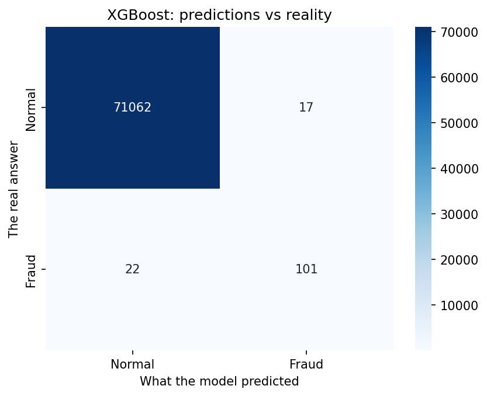
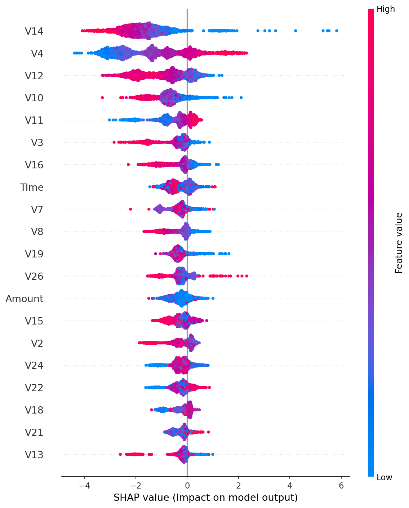
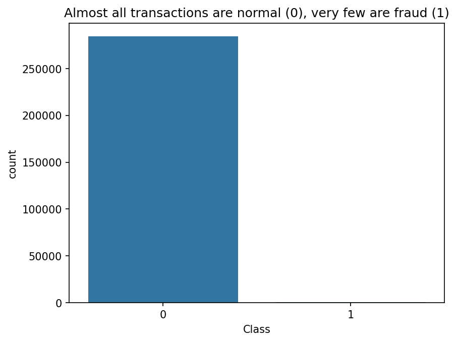

# Credit Card Fraud Detection

Detecting fraudulent credit card transactions: a binary classification problem on highly imbalanced tabular data. This project walks the full machine learning pipeline, from exploratory analysis to an interpretable, evaluated model.

## Problem

Card payment networks process enormous volumes of transactions every day, and a very small fraction of them are fraudulent (someone using a card or card details that are not theirs). Fraud is costly for banks and customers alike, so institutions rely on automated systems that flag suspicious transactions in real time for review or blocking. The aim of this project is to build and evaluate such a classifier.

Formally, given a set of anonymized numerical features describing a transaction, the task is to predict whether the transaction is **fraudulent (1)** or **legitimate (0)**. This is a binary classification problem.

**Why this problem is hard:**

- **Severe class imbalance.** Fraud accounts for only about 0.17% of transactions. A model that always predicts "legitimate" would be 99.8% accurate while catching no fraud at all, which makes plain accuracy a misleading metric. Evaluation therefore uses Precision-Recall AUC, recall, precision, and the confusion matrix.
- **Asymmetric error costs.** The two mistakes are not equal. A *missed fraud* (false negative) means money is lost, while a *false alarm* (false positive) inconveniences an honest customer and creates review workload. A good model balances catching fraud (recall) against keeping false alarms low (precision).
- **Need for explainability.** In regulated finance, a flag must be justifiable. The model's decisions are therefore examined with SHAP to show which features drive a prediction, rather than treating the model as a black box.

**Why it matters:** fraud detection is a widely used, high-impact application of machine learning. The techniques used here (handling imbalance, choosing the right metrics, and explaining predictions) transfer to many other real-world classification problems where the positive class is rare and the cost of errors is uneven, such as medical screening or network intrusion detection.

## Dataset

- **Name:** Credit Card Fraud Detection
- **Original source:** Machine Learning Group, Université Libre de Bruxelles (ULB) / Worldline. Used in peer-reviewed research. Mirrored on Kaggle.
- **Size:** 284,807 transactions, 492 fraud cases (0.172%).
- **Features:** 28 PCA-anonymized numeric features (`V1`–`V28`), plus `Time`, `Amount`, and the target `Class` (1 = fraud, 0 = legitimate).

> The raw data is not committed to this repo (see `.gitignore`). The notebook downloads it automatically from Kaggle. A Kaggle API key (`kaggle.json`) is provided once when the first cell asks for it.

## Approach

| Pipeline stage | What this project does |
|---|---|
| Framing | Binary classification; cost of a missed fraud vs. a false alarm |
| EDA | Class imbalance, feature distributions, correlations |
| Preprocessing | Scale `Amount` and `Time`; train/test split (stratified) |
| Imbalance handling | Compare class weights vs. SMOTE |
| Baseline model | Logistic Regression |
| Main model | XGBoost |
| Evaluation | Precision-Recall AUC, recall, F1, confusion matrix (not accuracy) |
| Interpretability | SHAP feature importance |

## Results

Tested on 71,202 held-out transactions (123 of them real fraud). The professional model (XGBoost) clearly beat the simple baseline.

| Metric | Logistic Regression (baseline) | **XGBoost (main model)** |
|---|---|---|
| PR-AUC | 0.706 | **0.852** |
| Recall (fraud caught) | n/a | **82.1%** |
| Precision (flags correct) | n/a | **85.6%** |
| F1 score | n/a | **0.838** |

**On the test set, XGBoost caught 101 of 123 frauds (82.1%), missed 22, and raised only 17 false alarms** out of more than 71,000 normal transactions. The jump in PR-AUC from 0.706 to 0.852 shows the stronger model earned its place over the baseline.

Key takeaway: the model catches most fraud while keeping false accusations low. This is a good balance for a real bank, where both missed fraud and false alarms are costly.

### Figures

**Confusion matrix (XGBoost):** predictions vs. reality on the test set.



**SHAP summary:** which features drive the model's fraud decisions.



**Class imbalance:** fraud is a tiny fraction of all transactions, which is why accuracy alone is misleading.



## How to run

### Option A: Google Colab (recommended)
1. Open `notebooks/fraud_detection.ipynb` in [Google Colab](https://colab.research.google.com).
2. Run the first cell and select the `kaggle.json` key when the "Choose Files" button appears. The dataset downloads automatically.
3. Run the remaining cells top to bottom (Runtime → Run all).

### Option B: Local
```bash
pip install -r requirements.txt
jupyter notebook notebooks/fraud_detection.ipynb
```

## Limitations

- Features are PCA-anonymized, so individual feature meanings are unknown.
- The dataset is from a specific time period and region; results may not generalize.
- This is a portfolio project, not a production fraud system.

## License

MIT. See [LICENSE](LICENSE).
